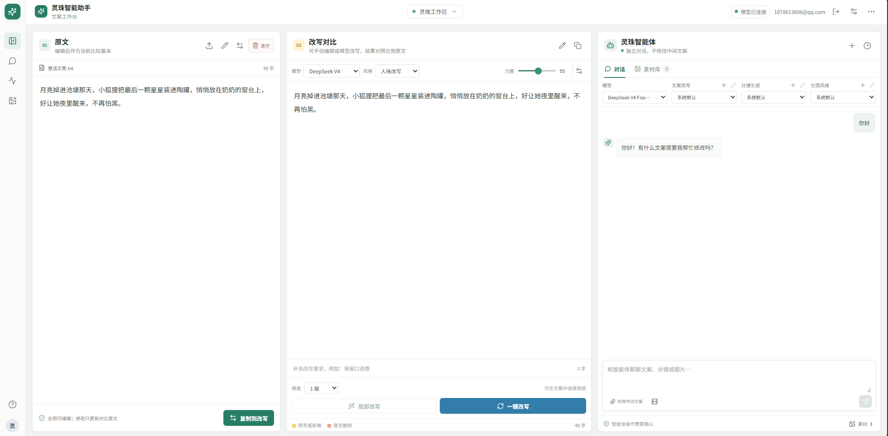
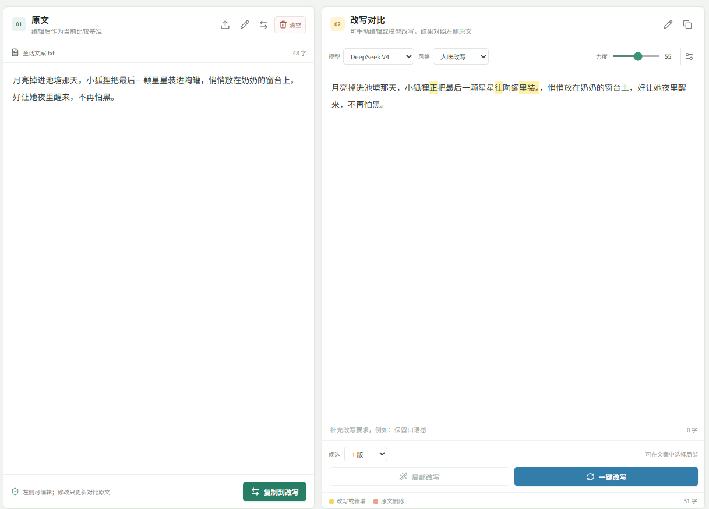
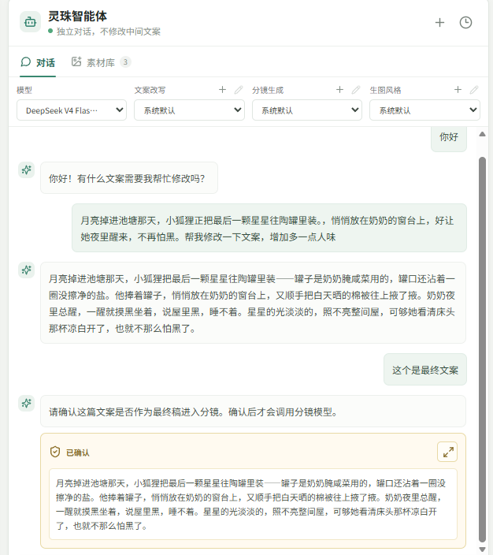
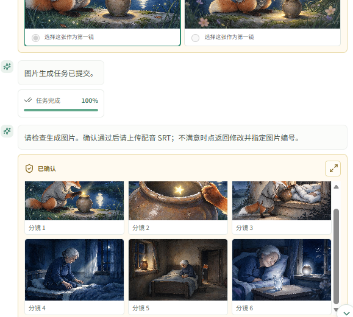
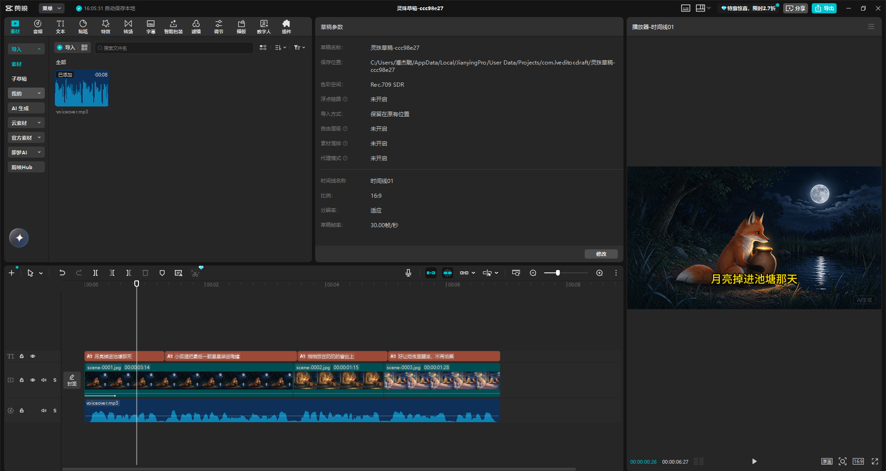

# 灵珠智能助手

灵珠智能助手是一个从文案编辑到剪映草稿生成的创作工作台：上传原文、对比改写、与智能体讨论并确认最终稿，再依次确认分镜、生成和审核图片，结合用户上传的配音与 SRT 字幕，生成可继续编辑的剪映草稿。

支持 Windows 本地运行和 Docker Compose 部署。容器版通过素材包与 Windows 导入工具交付草稿，用户电脑无需安装 Python；最终视频在剪映中检查并导出。

## 功能与操作流程

```text
上传原文 → 复制到改写 → 全文/局部改写与差异对比
    → 智能体讨论与定稿确认 → 分镜生成与确认
    → 生图风格样图选择 → 分镜图片生成与审核
    → 上传配音 + SRT → 时间线匹配
    → 下载素材包 → Windows 工具导入 → 剪映编辑与视频导出
```

### 1. 上传原文，建立独立的改写工作副本

工作台采用三栏布局：左侧保留原文，中间编辑改写稿，右侧与智能体对话或查看素材库。支持上传 TXT、MD、DOCX 和可提取文字的 PDF；点击“复制到改写”后创建工作副本，原文和改写稿均可手动编辑并保存版本。



### 2. 全文或局部改写，对照原文查看差异

选择模型、改写风格和力度，补充要求后执行全文改写，也可以选中文字进行局部改写。支持生成多个候选并切换结果。改写或新增内容以黄色标记，原文删除内容使用另一种颜色提示，便于逐处检查。更换对比原文时，可保留当前改写稿。



### 3. 与智能体讨论文案，确认最终稿和分镜

智能体支持流式回复，可以继续润色、扩写或调整表达；右侧聊天不会自动覆盖中间的改写稿。确定文案后，通过确认卡提交最终稿，再生成包含旁白和画面提示词的分镜。分镜需确认后才进入生图，也可以返回修改。

截图展示了对话改写以及最终文案确认卡。



### 4. 选择风格样图，生成并审核分镜图片

先生成第一镜风格样图，选择满意的样图后生成正式分镜图片。图片通过确认卡和素材库展示，支持放大查看、审核、指定镜头重新生成，以及单张或批量下载。后台任务显示进度，支持取消及失败后重试。



### 5. 上传配音与字幕，导入剪映继续编辑

图片审核通过后，上传包含配音音频和 SRT 字幕的素材文件夹。系统校验字幕与分镜文案的匹配情况，并按字幕时间组织图片、音频和字幕轨道。

容器/云端模式下，任务完成后下载剪映素材包及 Windows 导入工具。双击 EXE，选择素材包和本机剪映草稿目录，即可生成草稿；工具通常只需下载一次，升级时再更新。Windows 本地后端也支持直接写入本机草稿目录。

下面是草稿在剪映中打开后的结果：图片、配音和字幕已进入时间线，可以继续修改，再由剪映导出视频。当前流程交付的是可编辑草稿，不是服务端渲染的 MP4。



详细说明：[容器部署](docs/容器部署第一步.md) · [素材包与 Windows 本机导入](docs/剪映素材包本机导入.md)。剪映版本和自定义草稿目录可能不同，请在实际使用版本中检查导入结果。

## 本地运行

需要 Python 3.11 或更新版本、Node.js 20 或更新版本，并启动 PostgreSQL 与 Redis。将项目根目录 `.env.example` 复制为 `.env`，配置数据库、队列和需要使用的模型；不要把 `.env` 提交到代码仓库。

在项目根目录打开 PowerShell：

```powershell
py -3 -m venv .venv
.\.venv\Scripts\python.exe -m pip install -r apps/server/requirements.txt
npm.cmd install
```

终端一启动后端：

```powershell
.\.venv\Scripts\python.exe -m uvicorn app.main:app --app-dir apps/server --reload --port 8000
```

终端二启动 Celery Worker（Windows 使用 solo 单进程模式）：

```powershell
Push-Location .\apps\server
try { & ..\..\.venv\Scripts\python.exe -m celery -A app.workers.celery_app:celery_app worker --loglevel=INFO --pool=solo } finally { Pop-Location }
```

终端三单独启动 Beat，负责 Outbox 投递和超时恢复扫描。Windows 不支持在 Worker 中使用 `--beat`；同一套服务只启动一个 Beat：

```powershell
Push-Location .\apps\server
try { & ..\..\.venv\Scripts\python.exe -m celery -A app.workers.celery_app:celery_app beat --loglevel=INFO } finally { Pop-Location }
```

终端四启动前端：

```powershell
npm.cmd run dev
```

浏览器打开 `http://127.0.0.1:5173`。接口文档位于 `http://127.0.0.1:8000/docs`。

## 账号与数据隔离

首次使用需要注册邮箱账号，密码至少 10 位。登录状态由服务端 HttpOnly Cookie 维护，退出登录后服务端会撤销会话。生产环境必须通过 HTTPS 部署；HTTPS 请求会自动启用 Secure Cookie，也可在反向代理场景中设置 `AUTH_COOKIE_SECURE=true`。

已有数据库的旧工作区和自定义智能体提示词不会自动分配给首个注册用户。确认应由哪个账号继承后，先注册该账号，再在 `apps/server` 目录运行：

```powershell
..\..\.venv\Scripts\python.exe -m scripts.assign_legacy_data --email owner@example.com
```

该命令只把尚未分配的旧工作区及自定义提示词绑定到指定账号；新账号只会看到自己工作区中的文档、改写记录、对话、任务、字幕和素材。系统默认提示词保持共享。

## 模型配置

没有模型密钥时，页面会标记“本地体验模式”，可体验上传、复制、改写对比和素材审核流程；体验改写只进行少量固定词语替换，不代表真实大模型效果。

真实模型从环境变量读取密钥，不会写入数据库或日志。可以复制项目根目录 `.env.example` 为 `.env`，按需填写 `DEEPSEEK_API_KEY`、`DASHSCOPE_API_KEY` 或火山方舟的 `ARK_API_KEY` 与 `DOUBAO_MODEL`。模型下拉框包含 DeepSeek V4 Flash（深度求索）、Qwen3.7 Plus（通义千问）和 Doubao 2.1 Pro（豆包）；没有对应密钥时会显示体验模式。豆包通过火山方舟接入点调用，`DOUBAO_MODEL` 应填写指向豆包 2.1 Pro 的接入点 ID（通常以 `ep-` 开头）。如需禁用真实模型并强制体验模式，将 `DEMO_MODE` 设为 `true`。修改环境变量后重启后端。

## 数据存储和队列

- PostgreSQL 保存工作区、原文、工作副本、改写历史、会话、素材元数据和任务状态。
- Redis 0 号逻辑库作为 Celery 任务代理，1 号逻辑库存储短期任务结果。Celery worker 需要单独启动；仅启动 API 时，生成任务不会执行。
- 媒体 Job 与 Outbox 投递事件在同一 PostgreSQL 事务写入；Beat 会补投未成功发送的事件，并回收心跳超时的 Worker 任务。任务最多重试 `JOB_MAX_ATTEMPTS` 次（默认 5 次），超过后以 `dead_letter` 状态保留在 `jobs` 表中供排查。
- Worker 心跳默认每 `JOB_HEARTBEAT_SECONDS`（30 秒）更新；超过 `JOB_STALE_SECONDS`（180 秒）未更新会被回收。Outbox 默认每 `JOB_OUTBOX_POLL_SECONDS`（10 秒）扫描，投递租约为 `JOB_OUTBOX_LOCK_SECONDS`（120 秒）。Celery 消息采用 late ack；同一套服务单独运行一个 Beat 调度器。失败任务卡片提供重新提交操作。
- 智能体按 `AGENT_INPUT_TOKEN_BUDGET`（默认 16000 token）估算普通聊天上下文；接近预算预警时由 Celery 后台摘要较早对话中的偏好和修改方向。用户粘贴的长文就是普通聊天消息，数据库和聊天界面都保留全文，前端折叠显示；后续请求不重复携带这条长文正文。
- 智能体聊天使用 SSE（服务器发送事件）逐段返回。点击“附带中间文案”只把文案附加到本次模型请求；历史消息按 token 预算携带，预警时压缩较早对话摘要。
- 用户在聊天里说明要修改的段落和修改方式时，模型按要求回复目标内容；明确要求整篇改写或返回全文时才返回完整稿。长消息在聊天界面折叠展示，数据库仍保存完整普通聊天记录。
- 可在 `apps/server` 目录运行 `..\..\.venv\Scripts\python.exe -m scripts.check_connections`，检查 PostgreSQL 和 Redis 连接状态；输出不含密码。
- 项目已有的 SQLite 数据可在确认 PostgreSQL 是空库后迁移：在 `apps/server` 目录执行 `..\.\.venv\Scripts\python.exe -m scripts.migrate_sqlite_to_postgres`。目标库有业务记录时脚本会停止，不覆盖。SQLite 文件会保留在 `apps/server/data/lingzhu.db`。
- 未配置 S3/OSS 时，上传文档、字幕、配音、图片和预览保存在 `apps/server/data`，适用于单机开发。配置完整的 S3/OSS 参数后，上述文件统一存入私有 Bucket，数据库保存 `storage://` 对象引用；API、Celery worker 和多个服务实例通过同一 Bucket 读写。Bucket 应保持阻止公共访问开启，应用先校验用户归属，再代理文件下载。剪映草稿仍需在能访问用户剪映目录的本机导出端生成；云端只负责共享保存文件和生成时间线导出包。
- OSS 接入后可在 `apps/server` 目录先检查旧文件，再执行迁移：`..\..\.venv\Scripts\python.exe -m scripts.migrate_files_to_object_storage --dry-run`；确认文件归属已绑定用户且检查通过后，执行 `..\..\.venv\Scripts\python.exe -m scripts.migrate_files_to_object_storage`。迁移成功后原本地文件会保留，确认云端文件可读并完成备份后再按保留策略清理本地副本。

## 功能说明

- 文档支持 TXT、MD、DOCX 和可提取文本的 PDF；原文件按存储配置保存在本地或私有 OSS，解析文本和版本存入 PostgreSQL。
- 普通改写走单独模型服务；右侧对话经过 LangGraph 对话图，不会自动修改中间文案。
- 右侧智能体按确认阶段推进：最终文案确认后生成分镜，确认分镜后由后台任务调用即梦逐镜生图，图片确认后等待配音素材文件夹；上传后匹配已确认图片。`JIANYING_EXPORT_MODE=local` 时在 Windows 本机生成草稿，`package` 时提供素材包下载，再使用 Windows EXE 导入工具在用户电脑生成草稿。流程暂停状态保存在 PostgreSQL 的 LangGraph 检查点表中。
- 普通改写提示词集中在 `apps/server/app/prompts/normal_rewrite_prompts.py`；前端只提交 `styleId` 和补充要求，后端根据风格编号加载对应 `promptId`。新增普通改写风格时只需在该文件增加配置项。
- 正式图片生成需要配置图片供应商密钥；部分旧体验流程支持演示占位图。剪映导入效果以 Windows 本机目标剪映版本的实际检查为准。
- 运行日志输出到后端控制台，并滚动写入 `apps/server/data/logs/server.log`（单文件最多 5MB，保留 3 个旧文件）。常规轮询请求和访问日志已关闭；业务日志记录文档上传、复制到改写、改写完成、后台任务及失败信息，不记录模型密钥或全文文案。PowerShell 可用 `Get-Content .\apps\server\data\logs\server.log -Tail 100 -Wait -Encoding utf8` 实时查看。
- 左侧“清空当前工作台”只移除当前页面的原文、改写稿和浏览器恢复标记；已保存的原文、文案版本、改写及会话历史仍保留在本地数据库。
- 改写会话会保留最初来源文档；上传另一篇原文时，左侧切换到新文案作为比较基准，中间工作副本保持不变。点击“复制到改写”会基于当前左侧文案新建会话，旧会话仍保留。
- 左侧和中间都支持手动编辑：左侧保存为新的原文内容并更新当前对比基准；中间保存为新的工作副本。中间处于未保存的手动编辑状态时，模型改写按钮会收起，保存或取消后仍可继续模型改写。手动编辑不会调用模型。
- 生图和视频任务由 Celery worker 通过 Redis 队列执行；任务状态保存在 PostgreSQL。

## 测试与构建

```powershell
.\.venv\Scripts\python.exe -m pytest
npm.cmd run build
```
